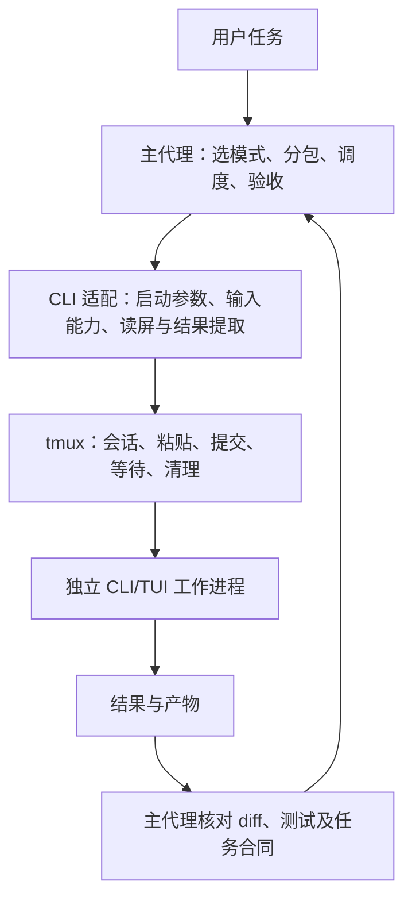

# tmux-terminal-control

隔离 tmux 会话的终端操控工具：Agent Skill、Python 标准库辅助脚本、假 TUI 和 unittest。Notion：[工作流与版本说明](https://app.notion.com/p/3f89f9a4e09e810e968bf0028aade8f8)、[早期终端设计](https://app.notion.com/p/3f99f9a4e09e8105878fc27cc06fe938)。

## 统一技能首版

已新增 [peer-coworkers](skills/peer-coworkers/SKILL.md)：统一任务分工、CLI 交互、结果校验与主代理验收。Linux/WSL 使用 Python 标准库和 tmux，不新增 pip 依赖。

模型按任务选择，不固定品牌或等级。首次派工比较候选并说明理由，独立复核优先考虑胜任的不同模型家族；能力边界、思考档位与调查证据见 [模型能力与选型](skills/peer-coworkers/references/model-selection.md)。`init` 现要求显式传入 `--profile`，省略时会报参数错误；`--model` 仍是可选的单任务设置，已有任务记录不受影响。

按用户偏好，**默认标准速度，不启用 Fast；只有用户当次明确要求才启用**。模型、思考档位和速度分别确认，Gemini Flash 不属于 Fast 开关。该规则由技能选型与会话核对执行；脚本没有通用的 Fast 开关，不改全局配置。更新范围、验证和已知限制见 [本次选型修复记录](docs/model-selection-validation.md)。

```bash
python3 scripts/install-skill.py
python3 "${CODEX_HOME:-$HOME/.codex}/skills/peer-coworkers/scripts/cowork.py" doctor
```

安装器把完整包写入 `${CODEX_HOME:-$HOME/.codex}/skills/peer-coworkers`，更新前备份旧目录，不改全局 CLI 配置。仓库中的四个底层脚本通过符号链接复用 `tmux-tui`；安装时物化为普通文件，因此安装后的新技能独立可用，旧技能仍保留。原生 Windows 安装暂未实现，Windows 调用端通过 WSL 使用。

| CLI | 首版配置 | 本次调用策略 |
|---|---|---|
| Codex | 可选；`--profile codex`，使用已有登录，经独立 tmux 进程工作 | 有历史任务与结果闭环证据，具体模型按任务选择 |
| agy | 可选；保留全局模型设置，可按任务显式选模型 | Gemini 3.8 Flash High 与 Claude Sonnet 4.6 均已通过真实任务闭环 |
| Cursor CLI | 可选；`--profile cursor`，使用 `cursor-agent` 或 `agent` | 已通过真实任务读取、结果交付、主代理验收与清理 |
| OpenCode | 仅兼容候选，默认关闭 | 用户尚未购买，本次不调用，也不自动回退到它 |

协作示例：`使用 $peer-coworkers，把任务分成实现与独立审查；使用已登录的 CLI，OpenCode 保持关闭。`

Cursor 使用的是终端中的 **Cursor Agent CLI**，官方当前命令为 `agent`，也有 `cursor-agent` 别名；编辑器启动命令 `cursor` 不作为工作进程。统一入口优先解析更明确的 `cursor-agent`，缺失时再查 `agent`，默认传入 `--sandbox enabled`；沿用已有登录与默认模型，不传自动批准或强制信任参数。命令和参数依据 [Cursor CLI 官方说明](https://cursor.com/docs/cli/reference/parameters)。

```bash
python3 skills/peer-coworkers/scripts/cowork.py init --cwd /absolute/git/worktree --role research --profile cursor --goal '查明具体问题并给出证据' --acceptance '结论有可定位依据，工作区没有变化'
# 随后按下文流程使用返回的 RUN，先 proxy_on 再 start。
```

**本机调用工作进程前先执行 `proxy_on`。** 它是交互 Bash 函数，请把开启代理与启动写在同一次调用中；开启失败时停止启动。agy 还可显式传入本机的代理入口：

```bash
# RUN 替换为 init 返回的绝对目录。
bash -ic 'proxy_on && python3 "${CODEX_HOME:-$HOME/.codex}/skills/peer-coworkers/scripts/cowork.py" start --run RUN'
bash -ic 'proxy_on && python3 "${CODEX_HOME:-$HOME/.codex}/skills/peer-coworkers/scripts/cowork.py" start --run RUN --proxy-url http://127.0.0.1:17890'
```

`--proxy-url` 在创建 tmux server 时传入 HTTP_PROXY/HTTPS_PROXY/ALL_PROXY 及小写同名变量，并保留本地 NO_PROXY。`proxy_on` 本身控制 WSL 透明代理，不会自动导出这些变量；真实请求能否成功仍须实测。端口是本机配置，其他机器按其实际代理填写。

**本机 agy / Gemini 已修复。** WSL 中间代理原先提前把域名解析为 IPv4，导致请求路径与 Windows 不同，并触发地区错误。已修改本机代理配置生成器：显式代理请求保留域名，透明 HTTPS 流量则按识别到的 Antigravity API 域名转发。原端口 `17890`、已有账号、Gemini 3.8 Flash High 与默认 daily-cloudcode 后端均验证成功；未切换 Windows 节点。

日常可直接执行 `proxy_on` 后启动 `agy`；技能工作包继续使用上面的 `--proxy-url` 命令，模型可显式绑定为 `init --profile agy --model gemini-3.8-flash-high ...`。`--model` 只影响本任务，不修改全局默认。真实 Gemini 工作进程已完成读取任务、写结果、主代理验收和清理。修复证据、配置备份及回滚见 [agy 排障记录](docs/agy-wsl-diagnosis.md)；[代理补丁](docs/patches/wsl-proxy-preserve-domains.patch) 仅记录本机配置变化，技能安装器不会修改其他机器的系统代理。

命令流程为 `init → start → screen → paste → screen → submit → observe → collect → accept → close`，具体参数见 [任务合同](skills/peer-coworkers/references/task-contract.md)。主代理逐步调度，工具不会自动批准权限、重发提交或把 DONE 当作验收通过。并行模式已有规则与跨 runs-dir 的共享工作区互斥；worktree 创建和集成仍由主代理执行。

`scope_check_exclusions` 会在任务说明与收集结果中明确列出未覆盖的忽略文件和工作区外路径，主代理须另行核对有关产物；空 scope_violations 不表示全盘无变化。用户状态目录不同的调用与工具外写者仍需协调。新旧实测结果分别记录，不把历史版本兼容性扩展到当前版本。

2026-10-21 在 WSL Debian13 / dev 验证 **114 项自动化测试通过、0 跳过**；本次核对了模型目录与官方资料，未重跑在线工作包或模型性能横测。结果与安装检查见 [选型修复验证](docs/model-selection-validation.md)。2026-10-17 另一环境的首版记录为 112 项通过；当时 Codex、agy / Gemini、agy / Claude 和 Cursor Auto 已完成真实任务闭环。历史证据见 [首版验收](docs/peer-coworkers-acceptance.md) 与 [首版测试输出](docs/peer-coworkers-test-results.txt)，不等于当前版本或具体模型已全面验收。

## 与 Peer Coworkers 的整合设计

2026-10-17：已按「协作编排 → CLI 适配 → tmux 操作」三层实现统一技能首版。本节保留设计依据与后续路线；页面下方的底层安装和命令仍对应现有 `tmux-tui`。

分析依据是当前仓库代码与 `peer_coworkers` 的提交 `2016c9c2ec7c5f8ea16917c6c46c7c057a70c78f`，主要参考其 [编排技能](https://github.com/g2uzi2018-stack/peer_coworkers/blob/2016c9c2ec7c5f8ea16917c6c46c7c057a70c78f/skills/adversarial-modes/SKILL.md)、[调用合同](https://github.com/g2uzi2018-stack/peer_coworkers/blob/2016c9c2ec7c5f8ea16917c6c46c7c057a70c78f/skills/deepseek-peer/SKILL.md) 和 [已知限制](https://github.com/g2uzi2018-stack/peer_coworkers/blob/2016c9c2ec7c5f8ea16917c6c46c7c057a70c78f/docs/known-limitations.md)。

### 两个项目各自解决什么

| 来源 | 已有能力 | 整合时的处理 |
|---|---|---|
| `tmux-terminal-control` | 隔离会话、原样粘贴、单次提交、读屏、有限等待、续等和精确清理 | 保留底层脚本及接口；它提供执行通道，尚不负责分工和成果验收 |
| `peer_coworkers/adversarial-modes` | 六种协作模式、任务分包、文件归属、独立审查、修复轮次限制、主代理裁决 | 提取为与模型无关的编排规则，去掉 Luna/DeepSeek 固定身份和按模型分工 |
| `peer_coworkers/deepseek-peer` | 有界结果合同、调用与成果状态区分、路径范围和实际 diff 核验 | 复用原则，按新通道重新实现必要检查；旧 runner 的隔离与校验不会随 tmux 自动继承 |
| 旧调用与安装配置 | DeepSeek 专用 Responses 调用、密钥设置、原生 `luna_peer` role、相关全局配置片段 | 按用户决定退出新方案；不作为默认入口、依赖或故障回退 |

停用的是旧调用方式。新方案通过用户选择的独立 CLI/TUI 进程协作；是否使用某个模型由 CLI 的实际配置决定，不从程序名推断，也不自动更换。已有 Codex、OpenCode、agy 的记录是历史版本验收，不能据此宣称所有当前版本均可用。

### 统一入口与内部职责



主代理负责需求、接口、集成、争议裁决和对用户交付；工作进程承担边界清楚的工作包。把角色（实现、测试、审查）与 CLI/模型分开，按能力和可用性分配，不保留「语义工作固定 Luna、机械工作固定 DeepSeek」的路由。

一个安装目录包含编排规则和底层脚本；入口按需读取协作模式、任务合同及当前 CLI 的操作说明。当前目录如下：

```text
skills/peer-coworkers/
├── SKILL.md                          # 入口、分工、调度与验收
├── references/
│   ├── collaboration-modes.md        # 迁入并改写六种模式
│   ├── task-contract.md              # 任务、状态与结果合同
│   ├── terminal-control.md           # 迁入现有 tmux 操作规则
│   ├── cli-profiles.md               # 按 CLI/版本记录实测能力与限制
│   ├── model-selection.md            # 能力、思考/速度选择与证据边界
│   └── model-inventory.json          # 带日期和证据来源的模型目录快照
└── scripts/
    ├── common.py                     # 复用现有底层实现，安装时物化
    ├── session.py
    ├── input.py
    ├── wait.py
    ├── profiles.py                   # CLI 路径、启动参数与启用策略
    └── cowork.py                     # 任务与会话关联、范围检查和结果校验
```

先在当前仓库完成整合，`peer_coworkers` 作为协作规则来源。统一包稳定后再决定仓库命名与归档；迁移期保留 `tmux-tui` 的现有安装入口，避免两个活跃编排入口重复接管同一任务。打包时保留来源说明，并核对迁入文件的许可。

### 分工如何细化

| 场景 | 推荐模式 | 约束与验收 |
|---|---|---|
| 小改动、强耦合、协作收益不明确 | 主代理直接完成 | 不强制启动工作进程 |
| 已有改动，担心具体故障路径 | 定向攻击审查 | 指定故障与完整调用链；发现必须能定位或复现 |
| 需求有歧义、存在不同方案 | 独立求解 | 各自先看原始问题，主代理用证据比较 |
| 实现与破坏性测试可分离 | 实现 / 测试 | 明确双方文件归属，验证测试能识别目标缺陷 |
| 开工前有架构或工具争议 | 提案 / 批评 | 先形成提案，批评后重新确定实现任务 |
| 已完成一个实现包 | 实现 / 独立审查 | 使用独立上下文审查最终产物，主代理核验结论 |
| 接口稳定，存在独立工作流 | 并行拆分 | 写入使用独立 worktree 与不重叠归属，主代理逐个集成 |

默认先跑通「主代理 + 一个实现进程」，需要独立视角时再增加审查进程。进程数量按任务决定；同一工作区只允许一个写者，测试、格式化和生成器也算写入。worktree 隔离 Git 工作目录，不隔离网络、凭据或外部服务。工作进程不再自行分派其他进程。

保留原方案对无效循环的限制：每个工作包最多一次广泛审查、一次定向修复、一次增量复核；超出或合同变化就重新分包。高风险交付保留一次独立最终检查，其余按验收需要选择，不为凑齐流程反复调用。

### 需要补齐的任务协议

现有脚本知道 socket、pane 和等待轮次，但不知道工作包是否完成。统一技能需要补一份轻量任务记录，把两者关联起来：

- **任务合同**：`task_id`、目标、依赖、输入版本/基线、允许读取与写入的范围、禁止事项、验收证据、预期产物。
- **执行定位**：`attempt_id`、角色、CLI 绝对路径与 argv、实际版本及可确认的模型配置、cwd/worktree、socket/session/pane、目标 CLI 的会话 ID（若可获取）。
- **执行预算**：任务截止时间、并发上限、审查/修复余量；每次有限等待只是总预算中的一次观察。
- **结果合同**：沿用 `STATUS`、`RESULT`、`EVIDENCE`、`VALIDATION`、`REMAINING_WORK`、`RISKS` 六个语义字段，外层绑定 `task_id` 与 `attempt_id`。`STATUS` 为 `DONE/PARTIAL/BLOCKED`；`DONE` 必须无剩余工作，另两者必须列出具体未完成项。

首版可沿用原结果上限：六字段对象最多 8 KiB，每数组最多 12 项，每字符串最多 2,000 字符；外层任务标识另设小而明确的长度上限。原始终端画面不当作 JSON 直接解析，结果从本轮明确的输出文件或 CLI 导出中提取；缺字段、重复字段、错任务、旧轮次、截断或无效结果均不进入完成验收。

输出文件可作为首版约定，不依赖 CLI 原生结构化输出。结果格式正确只证明合同满足，仍须核对实际 diff、允许范围与测试；只读角色也要核对前后工作区变化。提示词中的允许路径不构成沙箱，外部 CLI 的真实工具权限、数据外发范围与用户授权仍须匹配。

任务记录放 WSL 用户状态目录，作为续接索引，不保存密钥或完整对话；支持工作区外的专用运行目录，活跃期间保留，结束后按交付需要清理。工作区活跃登记按 cwd 在用户状态目录共享，跨 runs-dir 防止冲突。tmux 的 `@owner=tmux-tui/v1` 继续表示底层会话归属，不用它代替工作包身份。现有等待状态仍只放 pane 选项，不改成另一套状态库。

必须区分三个维度：

| 维度 | 例子 | 含义 |
|---|---|---|
| 终端观察 | `prompt/still/exited/timeout/error` | 现有 `wait.py` 的观察结果；不代表任务成功 |
| 调度状态 | 待执行、运行中、等待授权、待验收、已验收、失败、取消 | 由主代理结合合同和实际证据更新；本轮提交是否确认单独记录 |
| 工作进程自报 | `DONE/PARTIAL/BLOCKED` | 工作进程的交付声明；`DONE` 先进入待验收 |

超时后先续等和诊断；提交是否成功不明时，不自动重发。会话丢失须核对已有文件与副作用后才决定新尝试，不能承诺跨进程恰好执行一次。取消只有在观察确认停止后才记为已取消；不把按过 Escape 当成已停止。

### 分阶段落地与验收

| 阶段 | 交付 | 当前状态与验收 |
|---|---|---|
| 0：分析 | 整合边界、结构和迁移计划 | 已完成；旧调用路线退出新方案 |
| 1：统一技能包 | 统一入口、协作模式、终端规则与 CLI 配置 | 已实现；安装物化底层脚本，不依赖旧 sibling skill、Luna role 或 DeepSeek 密钥配置 |
| 2：单进程闭环 | 任务记录、CLI 适配、结果校验与主代理验收 | 已实现；新增测试覆盖错任务/旧轮次、无效结果、重复提交和验收后变更；真实 CLI 按实测结果验收 |
| 3：独立审查与并行 | 独立上下文、worktree 归属及串行集成 | 已有模式规则、工作区冲突检查与真实独立审查；自动创建/集成 worktree 和多写入流实测尚未实现 |
| 4：安装迁移 | 新安装器与旧入口兼容 | 已实现独立包安装与可恢复备份；旧 provider/role 全局配置的自动迁移未实现，不整体覆盖用户配置 |

阶段 2 按可观察性选 CLI，不绑定某个模型。历史验收中，agy 的审批区域、OpenCode 的取消行为、Codex 的审批匹配以及 WSL 保活仍有未决项，见下文；接入时逐项复测。当前安装环境的 tmux 为 3.4，仓库历史验收为 3.5a；本次已在实际环境运行底层和编排测试，并单独验证真实 Codex 任务。假 TUI 测试通过不替代真实进程验收。

统一技能与原有 `tmux-tui` 并存；未修改 `peer_coworkers` 仓库、全局 CLI 配置或只读 Notion 设计。

## 安装

Linux/WSL 安装 Python 3 和 tmux（基准 3.5a），Debian 可 sudo apt-get install tmux python3，无 pip 依赖。整个 skills/tmux-tui 目录可安装至宿主的 skills 目录。脚本、tmux、目标处于同一环境，保留 TERM。Windows 从 wsl -d YOUR_DISTRO --cd /absolute/repo --exec python3 ... 调用；UTF-8 文本通过 stdin，不拼进命令字符串。CLI 用绝对路径，注意登录 Bash 与 --exec PATH 差异，见 [环境](docs/environment.md)。

## 接口（从仓库根目录调用）

| 脚本 / 子命令 | 参数与行为 | stdout / 退出码 |
|---|---|---|
| skills/tmux-tui/scripts/input.py paste | --socket、--pane；UTF-8 stdin，LF/CR 要求 --multiline-verified EVIDENCE，否则发送前拒绝；唯一 buffer、load-buffer + paste-buffer -p -r -d | reason=pasted bytes=N；成功 0、错误 1、参数错误 2 |
| input.py keys | --socket、--pane、重复 --key；预定义按键，Enter 禁用 | reason=keys；同上 |
| input.py submit | --socket、--pane、--received-confirmed；--key Enter/C-j/C-m（默认 Enter），只提交一次 | reason=submitted；同上 |
| skills/tmux-tui/scripts/wait.py submit-and-wait | --socket、--pane、--received-confirmed、--timeout-ms、--shell-timeout-ms；先基线后提交/观察，--key Enter/C-j/C-m | 0 prompt/still/exited、3 timeout、1 error/参数错误 |
| wait.py begin / resume | 同等待参数，begin 建无提交轮次，resume 续等、不重发 | 同上 |
| skills/tmux-tui/scripts/session.py new | --task、--cwd 必填；--socket 默认唯一 ai-tui- 名、--session cli、--history-limit 50000、--width 120、--height 40，-- 后绝对程序路径及 argv | JSON 对象含 socket/session/pane/cwd/task/owner/command；0/1/2 |
| session.py list | 扫描 TMUX_TMPDIR（默认 /tmp）下 tmux-UID 的 ai-tui- sockets，含 owned、任务和进程状态 | JSON 数组；0/1/2 |
| session.py cleanup | --socket、--session、--task；默认只清理已退出，明确结束活跃任务用 --allow-active | JSON 对象；0/1/2 |
| session.py prune | --socket 一个精确 ai-tui- 名称；只删除已确认 ConnectionRefused 的当前用户 socket，不能替代 cleanup | JSON 对象 `{"socket","removed":true}`；0/1/2 |

等待共用 --poll-ms 50、--still-ms 600、--prompt-lines 4、重复 --prompt LABEL=REGEX、--busy-regex REGEX、--no-screen。LABEL 是字母数字/下划线/连字符。--prompt-lines 从最后一个非空行往上数 N 个物理行，中间空行照常计数，末尾全是空白行时区域为空。--prompt 与 --busy-regex 使用 Python re；会触发警告的正则按参数错误处理，退出码 1，不提交。prompt 在这 N 行上逐行匹配，使用 ^/$ 和具体布局，用整个基线排除旧提示；busy regex 命中不积累静止时间。

第一行严格 reason=prompt|still|exited|timeout|error elapsed_ms=N changed=0|1；prompt 追加 match=LABEL，exited 可追加 exit_code=N。之后最多一份画面，stderr 诊断。所有 tmux 调用受共同截止时间限制，timeout-ms 必须至少比 shell-timeout-ms 短 250ms，建议 20s/30s，额外留 WSL 开销。

轮次只存 pane @aitui_baseline、@aitui_changed、@aitui_previous、@aitui_quiet_since，无状态文件；resume 要求已有有效状态。先看到基线变化后静止才 still；still/prompt 不是完成证明。socket/pane/capture 消失返回 error。

## 用法

    python3 skills/tmux-tui/scripts/session.py new --socket ai-tui-demo --task demo --cwd "$PWD" -- /absolute/cli
    printf '%s' '用户文本;' | python3 skills/tmux-tui/scripts/input.py paste --socket ai-tui-demo --pane %0
    tmux -L ai-tui-demo capture-pane -p -t %0
    # 确认已接收，调用方 Shell 超时 30 秒，才提交：
    python3 skills/tmux-tui/scripts/wait.py submit-and-wait --socket ai-tui-demo --pane %0 --received-confirmed --timeout-ms 20000 --shell-timeout-ms 30000 --prompt 'approval=^APPROVAL: .+$' --busy-regex '^BUSY'
    # 超时后续等，不重发 Enter：
    python3 skills/tmux-tui/scripts/wait.py resume --socket ai-tui-demo --pane %0 --timeout-ms 20000 --shell-timeout-ms 30000
    python3 skills/tmux-tui/scripts/session.py list
    python3 skills/tmux-tui/scripts/session.py cleanup --socket ai-tui-demo --session cli --task demo
    # 确认 no server 后，才可删除这一个失效 socket：
    python3 skills/tmux-tui/scripts/session.py prune --socket ai-tui-demo

粘贴 → 等待/读屏确认接收 → 单独提交 → 确认提交。多行能力必须按目标版本/界面实测并给 --multiline-verified 证据；参数不自动开启 paste。tmux 3.5a 无查询变量。未确认提交先诊断，不补 Enter。

new 用 -f /dev/null、pane 创建前 history-limit、空 shell → remain-on-exit → respawn，@owner=tmux-tui/v1、@task、@cwd。cleanup 核对标记和精确目标，不用无范围 kill-server。

## 测试

    python3 -m unittest discover -s tests -v

每例独立 socket、系统临时目录日志，结束清理；依赖缺失报错，不能跳过。覆盖原样输入、多行、单次提交、等待、续等、输出与隔离，不改真实 CLI 沙箱/审批。完整操作规则见 [SKILL.md](skills/tmux-tui/SKILL.md)。逐项覆盖见 [test-coverage.md](docs/test-coverage.md)，本机输出见 [test-results.txt](docs/test-results.txt)。

## 已知限制与版本验收

轮询可能错过两次采样间的瞬时变化；prompt 依赖区域/具体 regex，基线相同提示再次出现保守排除，正文泛词不可靠。多行能力由调用方声明，不能检测声明失真。同一 pane 必须串行。服务器退出后可能残留失效 socket，list 会报告 error。prune 只删除一个已确认 ConnectionRefused 的精确名称，不凭前缀删除不明端点，也不能替代 cleanup。测试只删除自己创建的精确 UUID 端点。长回答用该版本已验收的捕获或导出；静止不是任务完成。没出现审批框不等于操作被禁止。

真实 CLI 需人工逐项检查输入、提交、多行、取消、审批、完成、隐藏思考、长回答，记录系统/WSL/tmux/CLI 版本、日期、命令/配置、证据，升级后重测。下表是四轮之后的最终结论。不关闭审批/沙箱。

| 对象与版本 | 环境 / 日期 | 覆盖与结论 | 证据 |
|---|---|---|---|
| 假 TUI / tmux 3.5a / Python 3.13.5 | Debian 13.7 / WSL 2，2026-10-16 | 自动化 80 项通过、0 跳过。只说明假 TUI，不是真实 CLI 兼容 | docs/test-results.txt |
| Codex CLI 0.162.1 | 同上，tmux 3.5a | 可输入。单行提交得到 PONG。粘贴后立刻 Enter 未卡死，结论只限这一组合。多行输入区显示原文。`esc to interrupt` 时按一次 Escape 能停。长回答用 `--no-alt-screen` 加 `capture-pane -p -S -`。两个 `-c` 没有隐藏效果，并多一条 embedded mode 警告。家目录写入没有审批框，文件未创建。`curl -sI https://example.com` 没有审批框，画面为 Failed (exit 7)、无输出。`/status` 为 Workspace (granular)。保活未测 | docs/cli-acceptance.md |
| OpenCode 2.0.28 | 同上 | 可输入。单行提交得到 PONG。多行只显示 `[Pasted ~N lines]`，提交后未消毒导出含原文。一次 Escape，以及一次调用连发两次 Escape，生成都没有停。长回答用未消毒的 `session export`；高度 100 装不下 150 行。Thinking 用命令面板里的 hide/show。第三轮 Permissions=prompt 时没有审批框就写了家目录文件；第四轮 touch 探测文件同样没有审批框，文件已创建。保活未测 | docs/cli-acceptance.md |
| agy 1.3.5 | 同上 | 信任目录提示属于审批，明确授权后可输入。多行输入区显示原文。`esc to cancel` 时按一次 Escape 能停。40 行答案用加高 pane 能看到。Thought 行用 `/config` 的 Verbosity low 隐藏，用完改回。创建工作区外文件会弹出 `Allow creation of this file?`，锚定正则 `^Allow creation of this file\?$`。第三轮 `--prompt-lines 40` 返回 match。第四轮默认 4 行时该行是去掉末尾空行后的倒数第 7 行，返回 still；拒绝后文件不存在。保活未测 | docs/cli-acceptance.md |

Windows/WSL 调用端退出至少一分钟后的保活待测，不用 Linux 假 TUI 通过替代，不改全局保活配置。设计偏离见 [docs/design-deviations.md](docs/design-deviations.md)。

### 待办

1. agy 审批的提示区域：1.3.5 的审批问句在去掉末尾空行后的倒数第 7 行，默认 --prompt-lines 4 返回 still。待用 --prompt-lines 8 复测；通过后同步更新 SKILL.md 和 Notion Skill 页里的「待验证」。
2. WSL 保活：Windows 调用端的 wsl.exe 退出至少一分钟后，会话是否仍在，待人工测试。2026-10-15 19:40:43 WSL 重启时，已有会话全部消失，符合「WSL 关闭会结束进程」。
3. 已确认不可用或无法验证，不再补测，升级后复测：
   - OpenCode 2.0.28：Escape（一次，或一次调用连发两次）不能取消生成。
   - Codex 0.162.1：四轮都没有出现审批框，审批匹配无法验证。
   - OpenCode 2.0.28：Permissions=prompt 时没有审批框就写了工作区外文件。这是目标 CLI 的行为，不是本工具的问题。


### 假 TUI 演练

日志放系统临时目录。用会话返回的 pane ID 替换 %0，先 capture 确认启动，再 paste，核对日志/画面后 submit-and-wait。目标支持 --bracketed-paste on/off、--mode unchanged/still/animation/approval/body/quote/stale/busy/exit、接收/响应延迟和 --ignore-submit。

    logdir=$(mktemp -d)
    python3 skills/tmux-tui/scripts/session.py new --socket ai-tui-practice --task practice --cwd "$PWD" -- /usr/bin/python3 "$PWD/tests/fake_tui.py" --log "$logdir/input.jsonl" --mode approval

仅对该假 TUI 已开启的 bracketed paste 界面使用 --multiline-verified 'fake_tui/v1 paste on, verified by tests'。日志事件 raw（data_b64）、paste（text_b64）和 submit（count/text_b64）供核对，paste 不等于 submit。保留日志诊断后再 cleanup；活跃演练明确结束才加 --allow-active。

目标程序单参数时 tmux 会解释成 shell command。session.py 用 Python 的 os.execv 启动器逐项传递 argv，随后替换为目标，不把程序路径/参数拼进 shell 文本。创建成功只证明会话已建，不证明目标启动成功，必须读屏/查 pane_dead；启动失败画面保留。
