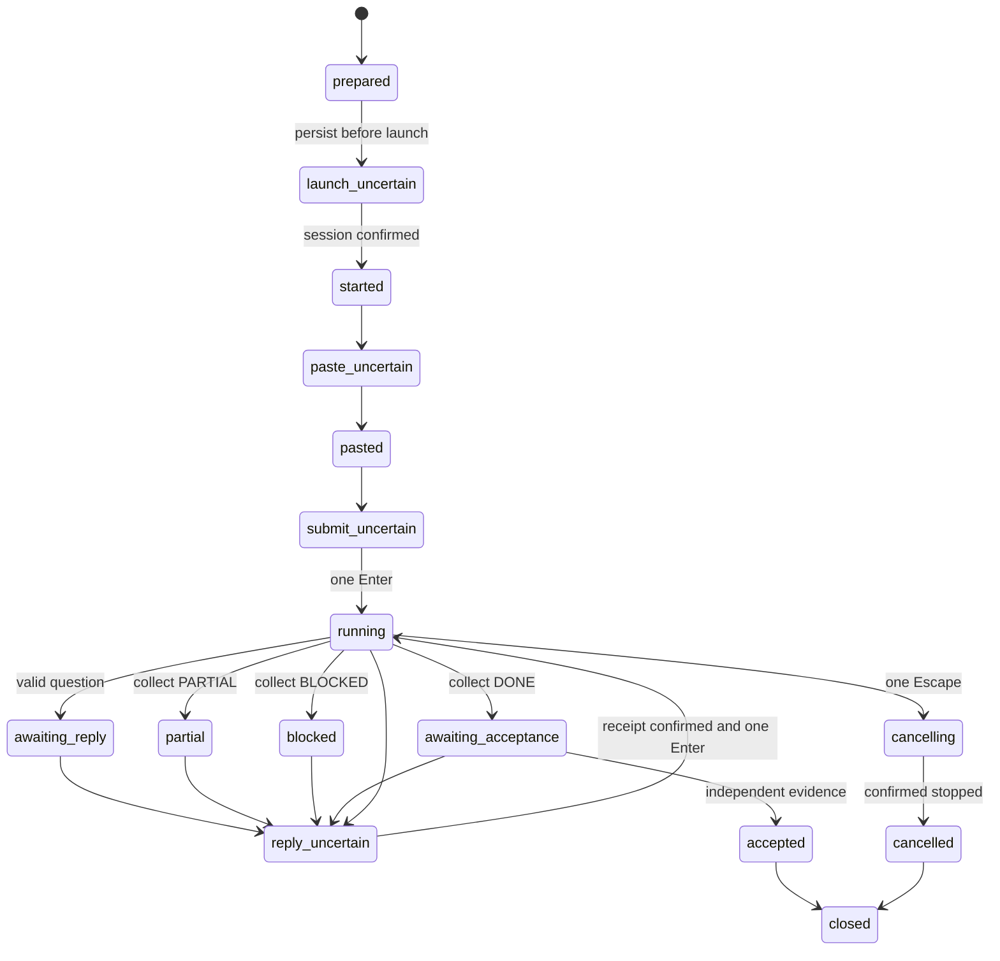

# Task states

The final `closed` node represents `closed=true`. Normal closure retains the task outcome in `state`; a disappeared session sets `state=closed` and `closed=true`. An unresolved launch without a confirmed pane is deliberately not closed automatically. Inspect it and its lease before an exact forced reap.

Every side effect has a persisted uncertain record first. A key intervention records `status=uncertain` before sending; success marks it `sent`. Cancel records `cancelling` and a current-round intervention first. Neither a leftover question nor a subsequent state change can clear that delivery evidence and cause another Escape in the same round. Replies enter `reply_uncertain`, increment the round and invalidate the previous result before sending. Failure after any of these stages requires inspection, not replay.

`wait` reasons are observations. Only a validated result can move through collection into `awaiting_acceptance`, and only independent evidence can accept it. `attention` is a screen-inspection cue; `approval` is a recognized prompt, not permission. When execution budget expires, reading, waiting, collecting, cancelling and closing remain possible; new task input and replies stop.

Approval is orthogonal metadata in `pending_approval`, not a task-completion state. An observed dialog receives an ID and screen hash with `status=waiting`. `decision` persists `uncertain` before navigation and marks `submitted` only after its single Enter. A footer change cannot rearm an uncertain decision. Once observation confirms the dialog is gone, waiting grace is settled; it is capped across all dialogs and rounds. Known waiting/uncertain approvals block `reply`.

New tasks separate startup from execution (`budget_origin=submission`). The work clock is persisted before the first Enter, including an uncertain delivery; replies never reset it. Legacy records keep launch-based time. `worker_ready` records a current-round control-file receipt, not task completion or acceptance. `budget_exhausted` distinguishes exhausted work from a single observation timeout; a late valid result remains readable and collectible.
