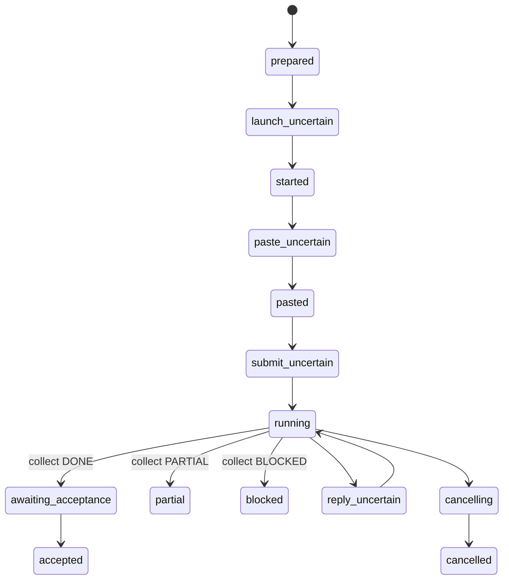

# Task states

A launch, paste or submission records uncertainty before its terminal side effect. A confirmed send or a valid handoff at the current path resolves submit/reply uncertainty. Feedback allocates a fresh path and keeps the prior file. `QUESTION` requests input through the same handoff as other outcomes. A queue is terminal evidence of waiting feedback.

Work time starts before initial Enter. Approval waiting receives capped grace and feedback keeps the same budget. Terminal observations and collection remain available after the deadline.

Approval is independent of task state. Decisions are single-attempt and bind the observed card. Close sets `closed=true`, retains an accepted outcome and releases the exact lease. Unaccepted `DONE` requires explicit discard if abandoned.
